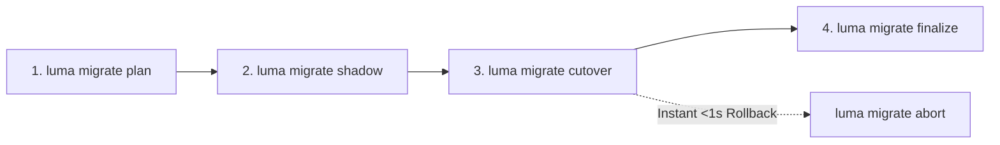

# 存量应用零停机迁移指南（Nomad 迁移至 K3s + Flux PaaS） {#zero-downtime-migration-guide-nomad-to-k3s-flux-paas}

Luma Next 提供完善的四步零停机迁移架构，支持将现有运行在 Nomad 上的生产应用平滑、无损地迁移至现代化的 **K3s + Tekton + BuildKit + Zot + Flux** PaaS 运行时底座。

因为业务迁移属于集群升级过程中的**一次性操作**，Luma 提供了专门的独立迁移脚本（`scripts/migrate-nomad-to-k3s.py`），同时在日常永久 CLI（`luma --help`）中隐藏迁移子命令（通过 `argparse.SUPPRESS`），确保开源新用户的命令行界面清爽直观。

## 一次性独立迁移脚本 {#one-time-standalone-migration-runner}

推荐的标准迁移执行入口是 `scripts/migrate-nomad-to-k3s.py`。该脚本自动执行集群前置检查、批次规划、并行影子发布、秒级流量切换及旧服务下线：

- `--dry-run`：执行前置内存、端口与集群探针检查，评估迁移计划而不变更任何线上工作负载。
- `--batch [1, 2, 3, all]`：执行指定批次（1、2、3）或全量批次的自动化迁移。
- `--project <name>`（或 `--app <name>`）：迁移单个指定的应用程序。
- `--state-file <path>`：记录迁移进度与切流状态文件（默认：`.luma-migration-state.json`）。
- `--decommission-nomad`：在所有业务验证完成后，自动停止并禁用宿主机上的旧 Nomad 服务。

```bash
# Dry-run preflight checks and evaluate rollout plan
python scripts/migrate-nomad-to-k3s.py --dry-run

# Migrate a specific rollout batch (1, 2, or 3)
python scripts/migrate-nomad-to-k3s.py --batch 1

# Migrate a specific application
python scripts/migrate-nomad-to-k3s.py --project serverx

# Migrate all workloads and decommission Nomad upon completion
python scripts/migrate-nomad-to-k3s.py --batch all --decommission-nomad
```

## 四步零停机迁移状态机流程 {#four-step-migration-state-machine}

底层迁移引擎执行严格的四步状态机（`plan -> shadow -> cutover -> finalize`），具备亚秒级即时回滚能力：



1. **`plan`（干跑评估，`luma migrate plan <app>`）**：
   - 自动解析应用的 `luma.yaml` 或 `luma.compose.yml`，划分迁移批次，识别可拆分为独立 K8s `Deployment` 的子服务与共享网络栈（`network_mode: service:*`）Sidecar，并检查存储卷 hostPath 绑定与密钥完整性。
2. **`shadow`（影子拉起，`luma migrate shadow <app>`）**：
   - 直接纳管当前线上正在运行的容器镜像 `sha256` 摘要生成不可变 `BuildArtifact`（`art-adopted-<app>-...`），无需重新构建镜像。
   - 在 K3s 中并行拉起 Shadow `HelmRelease` 并完成就绪探针校验，此时线上真实公网流量仍 100% 保持在原 Nomad 实例。
3. **`cutover`（秒级切流，`luma migrate cutover <app>`）**：
   - 将 Ingress 网关路由原子切换至已就绪的 K3s Service（`< 1s`）。
   - 旧 Nomad 任务进入温热备（`standby`）观察期（观察期内随时可执行 `luma migrate abort <app>` 在 `< 1s` 内切回原 Nomad 实例）。
4. **`finalize`（确认收尾，`luma migrate finalize <app>`）**：
   - 24 小时观察期无异常后，自动停止并清理旧 Nomad Job，同时校验无双活孤儿队列消费者残留。

## 存量应用分批迁移策略（3 个批次） {#rollout-batches-for-existing-applications}

根据应用状态与并发争抢风险，存量服务严格按 3 个批次分阶段推进：

| 批次 | 类别 | 包含存量应用 | 迁移策略 |
| :--- | :--- | :--- | :--- |
| **Phase 0** | 构建面先行接管 | 全部构建任务（`local` / `import`） | 率先切换至 Tekton + 远程 BuildKit 池 + Zot Registry |
| **Batch 1** | 无状态 Web 与轻量工具 | `tifenxia-fe`, `word2pdf`, `itool-tech`, `luxe-monitor`, `claude-remote` | 影子拉起 K3s Deployment -> 健康探针通过 -> 蓝绿无感切流 |
| **Batch 2** | 多服务 Compose 与异步队列 | `serverx`, `granary`, `codex-gitea` | 先切流后台队列消费者（如 `video-worker`）避免双活争抢 -> 影子验证 Web API -> 网关切流 |
| **Batch 3** | 带持久化本地卷的有状态服务 | `kato`, `bot` | 原地 Local PV 挂载纳管（保留原宿主机目录与 UID/GID `fsGroup` 权限，零数据拷贝）-> 受控切换 |

## 真实环境集群与节点迁移隐患防护 {#real-world-migration-hazards-and-safeguards}

在同一物理宿主机上并存迁移生产工作负载会面临资源与状态冲突，Luma 在前置与运行时施加了严格防护：

### 1. 同节点 Traefik 端口冲突规避与内存余量检查 {#same-node-traefik-port-coexistence-and-memory-headroom}

- **端口冲突防范（`80`/`443` 与 `tcp-relay`）**：
  当 Nomad 与 K3s 同时运行在同一台主机时，绝不能尝试重复绑定宿主机的 `80` 或 `443` 端口。边缘流量通过 Traefik 动态路由与 SNI 多路复用实现平滑切流，不占用重复 hostPort。对于四层 TCP 透传服务（`exposure: tcp-relay`），迁移前置检查确保 `publishPort` 相互隔离且不占用保留端口。
- **节点内存余量保障（>= 512 MB）**：
  在同一节点上并行拉起 shadow Pod 与存量 Nomad 实例会增加内存占用。迁移脚本前置校验宿主机可用内存（`SC_AVPHYS_PAGES`）；若空闲内存小于 512 MB 则阻断并行 shadow，防止触发 Linux OOM Killer 导致生产雪崩。

### 2. 有状态 SQLite / flock 卷隔离与单实例 Bot 保护 {#stateful-sqlite-flock-volumes-and-single-instance-bot-protection}

- **存储卷防损坏保护（`kato`, `bot`）**：
  使用 SQLite 数据库或文件排他锁（`flock`）的应用，**绝对不能**在 Nomad 与 K3s 中同时挂载并写入同一个 hostPath 目录！双写会导致 SQLite WAL 日志损坏和文件锁失效。
- **单实例 Bot 长轮询连接保护**：
  Telegram / 飞书长轮询 Bot 不可双活并发运行，否则会导致 API 409 Conflict 冲突、消息重复消费与断连震荡。
- **Shadow 与 Cutover 阶段的严格保证**：
  - **`shadow` 阶段**：有状态与 Bot 应用的副本数强制保持为 `replicas: 0`。仅预拉取容器镜像、同步密钥并校验存储卷 hostPath 权限与节点亲和（node pin），绝不拉起活跃容器进程。
  - **`cutover` 阶段**：迁移引擎严格在**停掉旧 Nomad 实例之后**，才将 K3s Deployment 扩容至 `1`，实现绝对的互斥与零锁争抢。

### 3. 迁移后彻底下线 Nomad 服务 {#post-migration-nomad-decommission}

当 Batch 1、2、3 所有业务全部完成 Finalize 确认并平稳运行后，执行旧 Nomad 守护进程的下线与停用，彻底释放系统内存、CPU 与网络套接字：

```bash
# Disable and stop legacy Nomad daemon after full cluster verification
sudo systemctl disable --now nomad
```

## 开源新手 0 到 1 安装体验与存量用户兼容性 {#fresh-0-to-1-install-vs-existing-migration-compatibility}

Luma 既为存量集群提供 100% 平滑过渡，又为开源新用户提供零心智负担的现代化体验：

- **开源新手 0 到 1 体验**：
  新用户在空白 Linux 服务器上直接部署 K3s + Flux，完全无需了解 Nomad 概念或执行迁移脚本。全流程使用统一的现代化标准命令：
  `luma bootstrap --domain ...`、`luma login`、`luma init`、`luma node join` 和 `luma manager cloudflare --zone ...`。
- **配置与环境变量零破坏性变更**：
  已有的 `.env` 环境变量保持 100% 向后兼容：
  `CLOUDFLARE_API_TOKEN`、`CLOUDFLARE_ZONE_ID`、`EGRESS_SUBSCRIPTION_URL` 和 `LUMA_DEPLOY_TOKEN` 无需修改即可直接生效。
- **开箱即用的 Cloudflare 联动**：
  Cloudflare DNS 与 Cloudflare Tunnel（`exposure: cloudflare-tunnel`）直接通过 Luma 内置命令（`luma manager cloudflare --zone ...`）自动联动，用户完全不需要手动安装或配置 Kubernetes `external-dns` 或 `cloudflared` 的复杂 CRD 资源。

```bash
# 0-to-1 Fresh install on an empty Linux server (zero Nomad knowledge required)
luma bootstrap --domain luma.example.com

# Configure Cloudflare DNS & Tunnel credentials seamlessly
luma manager cloudflare --zone example.com

# Deploy your first application directly to K3s + Flux
luma init --name web --port 8080
luma deploy web.yaml
```

## 常用 CLI 命令 {#cli-reference}

虽然推荐使用 `scripts/migrate-nomad-to-k3s.py` 脚本，但运维人员在需要逐步排查或精准控制时，仍可直接调用底层的 `luma migrate` 命令：

```bash
# View rollout batches and application classification
luma migrate batches

# Step 1: Generate migration plan
luma migrate plan serverx

# Step 2: Start parallel K3s shadow release (reusing existing image digest)
luma migrate shadow serverx

# Step 3: Cut over live traffic to K3s (keeps Nomad in standby)
luma migrate cutover serverx

# Optional: Instant <1s rollback to standby Nomad job
luma migrate abort serverx

# Step 4: Purge legacy Nomad job after 24h observation
luma migrate finalize serverx
```
