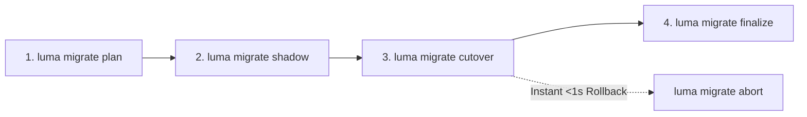

# Zero-Downtime Migration Guide (Nomad to K3s + Flux PaaS) {#zero-downtime-migration-guide-nomad-to-k3s-flux-paas}

Luma Next provides a robust, zero-downtime migration architecture to transition existing production applications from the legacy Nomad runtime to the modern **K3s + Tekton + BuildKit + Zot + Flux** PaaS runtime.

Because migration is a **one-time operation** performed when upgrading a cluster, Luma provides a dedicated standalone runner (`scripts/migrate-nomad-to-k3s.py`) while keeping one-time migration commands hidden (`argparse.SUPPRESS`) from the permanent daily CLI (`luma --help`) to preserve a clean developer experience for new open-source users.

## One-Time Standalone Migration Runner {#one-time-standalone-migration-runner}

The canonical migration tool is `scripts/migrate-nomad-to-k3s.py`. It automates cluster preflight checks, batch planning, parallel shadow deployments, traffic cutover, and legacy service decommissioning:

- `--dry-run`: Performs preflight memory, port, and cluster checks without modifying workloads.
- `--batch [1, 2, 3, all]`: Executes migration for a targeted rollout batch or all batches.
- `--project <name>` (or `--app <name>`): Migrates a single application.
- `--state-file <path>`: Records migration progress and cutover states (default: `.luma-migration-state.json`).
- `--decommission-nomad`: Automatically disables and stops the legacy Nomad service once all workloads are finalized.

```bash
# Dry-run preflight checks and evaluate rollout plan
python scripts/migrate-nomad-to-k3s.py --dry-run

# Migrate a specific rollout batch (1, 2, or 3)
python scripts/migrate-nomad-to-k3s.py --batch 1

# Migrate a specific application
python scripts/migrate-nomad-to-k3s.py --project serverx

# Migrate all workloads and decommission Nomad upon completion
python scripts/migrate-nomad-to-k3s.py --batch all --decommission-nomad
```

## Four-Step Migration State Machine {#four-step-migration-state-machine}

The underlying migration engine implements a 4-step state machine (`plan -> shadow -> cutover -> finalize`) with sub-second rollback capabilities:



1. **`plan` (`luma migrate plan <app>`)**:
   - Inspects `luma.yaml` and `luma.compose.yml`, classifies the application into rollout batches, identifies independent `Deployment` workloads versus `network_mode: service:*` sidecars, and validates volume hostPath bindings and secrets.
2. **`shadow` (`luma migrate shadow <app>`)**:
   - Adopts currently running container image digests (`sha256:...`) into an immutable `BuildArtifact` (`art-adopted-<app>-...`) without rebuilding images.
   - Deploys a parallel shadow Flux `HelmRelease` into K3s and validates health probes while production traffic remains on Nomad.
3. **`cutover` (`luma migrate cutover <app>`)**:
   - Atomically switches Ingress routing to the verified K3s release in `< 1s`.
   - Places the legacy Nomad allocation into warm `standby` during the 24-hour observation window (`abort` instantly restores traffic to Nomad if needed).
4. **`finalize` (`luma migrate finalize <app>`)**:
   - Purges the standby Nomad job after the observation window and confirms zero orphan queue workers remain.

## Rollout Batches for Existing Applications {#rollout-batches-for-existing-applications}

Workloads are segregated into three phased batches according to statefulness and concurrency risk:

| Batch | Category | Applications | Migration Strategy |
| :--- | :--- | :--- | :--- |
| **Phase 0** | Build Plane First | All builds (`local` / `import`) | Switch image builds to Tekton + Remote BuildKit + Zot Registry first |
| **Batch 1** | Stateless Web & Tools | `tifenxia-fe`, `word2pdf`, `itool-tech`, `luxe-monitor`, `claude-remote` | Shadow K3s Deployment -> Health Probe -> Blue/Green Ingress Cutover |
| **Batch 2** | Multi-Service Compose & Queue Workers | `serverx`, `granary`, `codex-gitea` | Drain/Switch Queue Workers (`video-worker`, `worker`) first -> Shadow Web API -> Ingress Cutover |
| **Batch 3** | Stateful Services with Local Volumes | `kato`, `bot` | In-Place Local PV Adoption (preserving host path & `fsGroup` UID/GID) -> Controlled Cutover |

## Real-World Migration Hazards & Safeguards {#real-world-migration-hazards-and-safeguards}

Migrating co-located workloads on production nodes introduces real-world resource and state hazards. Luma enforces strict preflight and runtime guards:

### 1. Same-Node Traefik Port Coexistence & Memory Headroom {#same-node-traefik-port-coexistence-and-memory-headroom}

- **Port Conflict Prevention (`80`/`443` & `tcp-relay`)**:
  When Nomad and K3s run concurrently on the same host, both runtimes must not attempt to bind duplicate host ports `80` or `443`. Edge traffic transitions cleanly through Traefik dynamic routing and SNI multiplexing without hostPort collisions. For raw L4 TCP services (`exposure: tcp-relay`), migration preflights ensure `publishPort` is distinct and never conflicts with reserved ports.
- **Node Memory Headroom (>= 512 MB)**:
  Running parallel shadow Pods alongside existing Nomad allocations increases memory footprint. The migration runner checks available host memory (`SC_AVPHYS_PAGES`); if free memory is below 512 MB, shadow deployment is halted to prevent triggering the Linux Out-Of-Memory (OOM) killer.

### 2. Stateful SQLite / flock Volumes & Single-Instance Bot Protection {#stateful-sqlite-flock-volumes-and-single-instance-bot-protection}

- **Volume Corruption Prevention (`kato`, `bot`)**:
  Applications utilizing SQLite databases or file locks (`flock`) must **never** mount and write to the same hostPath directory concurrently from both Nomad and K3s. Concurrent writes corrupt the SQLite WAL journal and break file locks.
- **Single-Instance Bot Connection Protection**:
  Polling bots (e.g., Telegram and Feishu bots) must not run concurrently; dual polling creates API 409 Conflict errors, message duplicate processing, and event flapping.
- **Shadow & Cutover Invariants**:
  - During **`shadow`**: Stateful and bot applications maintain `replicas: 0`. The shadow release pre-pulls container images, syncs secrets, and validates volume hostPath permissions and node pins without starting active processes.
  - During **`cutover`**: The engine strictly stops the legacy Nomad allocation **before** scaling the K3s Deployment up to `1`. This guarantees mutual exclusion and zero lock contention.

### 3. Post-Migration Nomad Decommission {#post-migration-nomad-decommission}

After all applications in Batches 1, 2, and 3 are finalized and verified in production, decommission the legacy Nomad daemon to reclaim system memory, CPU cycles, and network sockets:

```bash
# Disable and stop legacy Nomad daemon after full cluster verification
sudo systemctl disable --now nomad
```

## Fresh 0-to-1 Install vs. Existing Migration Compatibility {#fresh-0-to-1-install-vs-existing-migration-compatibility}

Luma maintains strict backward compatibility for existing clusters while providing a seamless, zero-friction experience for new open-source adopters:

- **0-to-1 Fresh Install Experience**:
  New users bootstrap directly onto K3s and Flux without needing any prior Nomad knowledge or running migration tools. The entire workflow uses standard commands:
  `luma bootstrap --domain ...`, `luma login`, `luma init`, `luma node join`, and `luma manager cloudflare --zone ...`.
- **Zero Breaking Changes to Configuration**:
  All existing environment variables in `.env` remain 100% compatible:
  `CLOUDFLARE_API_TOKEN`, `CLOUDFLARE_ZONE_ID`, `EGRESS_SUBSCRIPTION_URL`, and `LUMA_DEPLOY_TOKEN`.
- **Seamless Cloudflare Integration**:
  Cloudflare DNS and Cloudflare Tunnel (`exposure: cloudflare-tunnel`) configure automatically through Luma's built-in manager commands (`luma manager cloudflare --zone ...`) without requiring manual installation of Kubernetes `external-dns` or `cloudflared` Custom Resource Definitions (CRDs).

```bash
# 0-to-1 Fresh install on an empty Linux server (zero Nomad knowledge required)
luma bootstrap --domain luma.example.com

# Configure Cloudflare DNS & Tunnel credentials seamlessly
luma manager cloudflare --zone example.com

# Deploy your first application directly to K3s + Flux
luma init --name web --port 8080
luma deploy web.yaml
```

## CLI Reference {#cli-reference}

While `scripts/migrate-nomad-to-k3s.py` is the recommended standalone entry point, operators can also invoke the underlying low-level `luma migrate` commands for manual inspection or step-by-step troubleshooting:

```bash
# View rollout batches and application classification
luma migrate batches

# Step 1: Generate migration plan
luma migrate plan serverx

# Step 2: Start parallel K3s shadow release (reusing existing image digest)
luma migrate shadow serverx

# Step 3: Cut over live traffic to K3s (keeps Nomad in standby)
luma migrate cutover serverx

# Optional: Instant <1s rollback to standby Nomad job
luma migrate abort serverx

# Step 4: Purge legacy Nomad job after 24h observation
luma migrate finalize serverx
```

